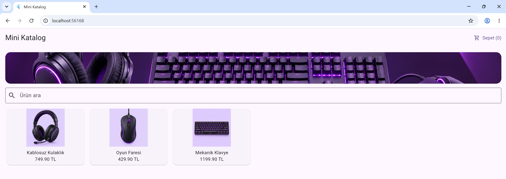
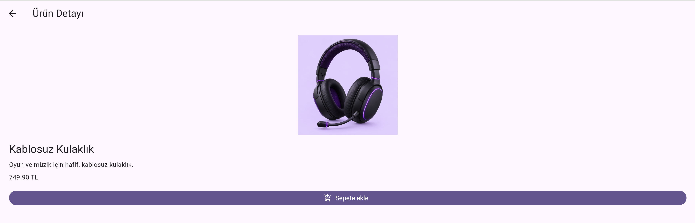
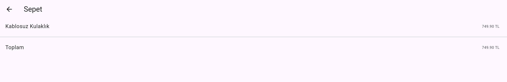
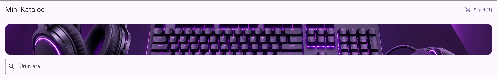

# Mini Katalog

Flutter ile geliştirilen bir ürün kataloğu uygulaması. Ürünler yerel bir JSON dosyasından yüklenir. Kullanıcı ürünleri arayabilir, detaylarını inceleyebilir ve sepete ekleyebilir. Sepet ekranı seçilen ürünleri ve toplam tutarı gösterir.

## Kullanılan sürümler

- Flutter 3.50.0 (stable)
- Dart 3.14.0

## Çalıştırma

Proje klasöründe terminali aç ve aşağıdaki komutları çalıştır.

```bash
flutter pub get
flutter run
```

Chrome'da açmak için `flutter run -d chrome` komutunu kullanabilirsin. Aşağıdaki ekran görüntüleri Chrome'da alınmıştır.

## Ekran görüntüleri

### Ana ekran


### Ürün detayı


### Sepet


### Sepet sayacı
